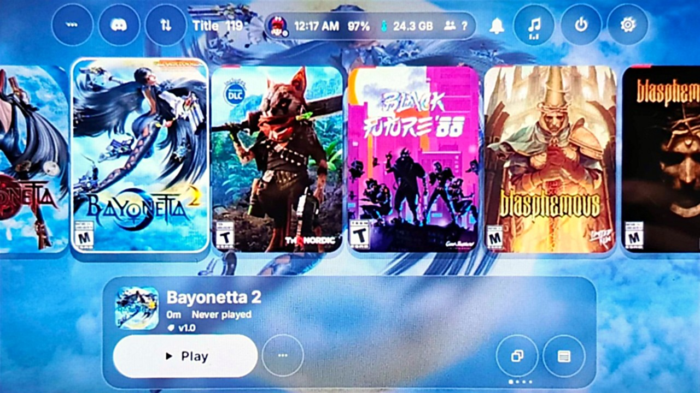

# HomeNX

A new HOME menu for modded Switch consoles. It has two looks: **CardsNX** shows box-art cards and the
**Wii U look** shows a grid. Your games, News, Social, Miis, Discord and Sphaira are one button away in both.
It's based on [SwitchU](https://github.com/PoloNX/SwitchU) by PoloNX and is free and open source (GPL-3.0).

Website: **[homenx.pages.dev](https://homenx.pages.dev)**



## Downloads

Everything is in the [latest release](https://github.com/ad3333m/homenx/releases/tag/latest).

| File | What it is |
|---|---|
| `HomeNX-full.zip` | Replaces the HOME menu. This is the one to install. Needs Atmosphère. |
| `HomeNX.nro` | The Wii U look as a normal app, opened from Sphaira or hbmenu. It changes nothing. |
| [`CardsNX.nro`](https://github.com/ad3333m/homenx/releases/tag/cardsnx) | The card look as a normal app. |
| `NXToggle.nro` | Picks the look, installs updates, and turns HomeNX off and on. HomeNX installs it for you. |
| `HomeNX-frontend.zip` | The smaller update package that NXToggle downloads. You don't need it by hand. |

## Installing

1. You need a Switch running Atmosphère.
2. Extract `HomeNX-full.zip` to the root of the SD card. It adds the `atmosphere/` and `switch/` folders.
3. Restart the console. HomeNX is now your HOME menu.
4. Open **NXToggle** from your homebrew menu. From there you can switch between CardsNX and the Wii U look,
   check for updates (it downloads and installs them on the console), or turn HomeNX off and on.

```
sdmc:/
├── atmosphere/contents/
│   └── 0100000000001000/   HomeNX
├── switch/
│   ├── SwitchU/            its files
│   ├── NXToggle/           look, updates, on/off
│   └── CardsNX/            the card look as an app
└── hbmenu.nro              HomeNX Loader (your old one is kept as hbmenu.nro.homenx-original)
```

**If the console stops at a black screen**, put the SD card in a computer and delete
`atmosphere/contents/0100000000001000`. The normal HOME menu comes back.

## CardsNX

- Your games are big box-art cards on frosted glass, with play time. The pages are Games, Homebrew, Media and
  Nintendo. Either stick moves through them.
- Art comes from SteamGridDB (add your own API key in Settings > Pictures) and GameTDB.
- **+** on a card lets you:
  - pick its cover or title picture (**Y** searches SteamGridDB for any name)
  - rename it
  - move it to another page (homebrew ports onto Games, for example)
  - put it on the panel button
  - delete it
- **X** asks whether to close the software that's open.
- **R** opens Quick Settings: music player, volumes, brightness, Airplane mode, Wi-Fi, Bluetooth and power.
- Settings > Look:
  - one background picture for everything (your own, or your newest screenshots)
  - the lock screen and its PIN
  - the launch animation
  - TV resolution
- Settings > Home: **Ask who's playing** lets you choose the profile when a game starts. **Panel button**
  picks what the button under the cards opens (News, nothing, or any app).
- Settings > Sound > Music player can show **Spotify** instead of HOME music.
  - It shows and controls what plays on your phone, computer or speaker, with the song, cover and volume.
  - You sign in by scanning a QR code with your phone on the same Wi-Fi.
  - You need your own Spotify app's Client ID from [developer.spotify.com](https://developer.spotify.com/dashboard).
    Its redirect URI must be `https://homenx.pages.dev/spotify/`.
  - The Switch doesn't play Spotify's audio itself, and Spotify only lets Premium accounts use the buttons.

## The Wii U look

- Games sit in a grid with folders and widgets (weather, calendar, a now-playing bar).
- There are ten side buttons, picked and ordered in Settings > HomeNX > Sidebar buttons from 17:
  - Sphaira, Discord, News and Settings
  - a custom button (any .nro, with your own icon)
  - Nintendo eShop, Controllers, Social, Theme Shop and Sleep
  - Nextendo, Music, Storage, Mii Maker and NXToggle
  - Reboot to Hekate and Homebrew Manager
- **R** opens Quick Settings and **L** opens Discord.
- **Glass effects** can be turned off for a steady 60 FPS.

## In both looks

- **Discord** is in HOME. Sign in with a QR code or a token. Over games, **L+ZL** opens it if you have the
  Ultrahand overlay. Discord may flag accounts that use third-party clients, so using it is at your own risk.
- **News** shows what's saved on your Switch, newest first, with unread dots.
- **Social** shows your friend list, friend requests, Add Friend and your play history. The **Mii Maker** is built
  in and shows real Mii faces.
- **Sphaira** is included. It and any other .nro can open as an application with full memory.
  - HomeNX borrows an installed game to run it.
  - **HomeNX Loader** (`sdmc:/hbmenu.nro`) chains to the app you picked.
- **The lock screen** shows when the console starts or wakes. It can ask for a 4-digit PIN, which both looks share.
  If you forget it, delete `sdmc:/config/SwitchU/lock_pin` on a computer.
- **1080p when docked** is a setting. It's off by default and starts the next time HOME opens.
- Every controller works, not only player 1.
- **Reboot to Hekate** is in the power menu.
- Updates install on the console with NXToggle, and HomeNX can be turned off without a PC.

## Building

You need [devkitPro](https://devkitpro.org/wiki/Getting_Started) devkitA64 (CI uses the `devkitpro/devkita64`
image), [xmake](https://xmake.io) and Python 3.

```bash
git clone --recursive https://github.com/ad3333m/homenx
cd homenx
```

The apps:

```bash
xmake f -p cross -m release -a aarch64 --toolchain=devkita64 --homebrew=y
xmake build SwitchU          # HomeNX.nro
xmake build SwitchU-Manager  # NXToggle.nro
xmake build CardsNX          # CardsNX.nro
```

The HOME menu replacement. The Loader is built into the menu, so build and embed it first:

```bash
xmake f -p cross -m release -a aarch64 --toolchain=devkita64
xmake build HomeNX-Loader
python3 tools/embed_loader.py build/cross/aarch64/release/HomeNX-Loader.nro projects/menu/src/generated/loader_nro.inc
xmake
```

The output goes to `build/cross/aarch64/release/`.
[`.github/workflows/switch.yml`](.github/workflows/switch.yml) does the rest:

- bundles Sphaira
- builds the Discord overlay (`make -C projects/overlay`)
- builds CardsNX's GameTDB index
- packs the SD card layout into the zips

## Credits

- [SwitchU](https://github.com/PoloNX/SwitchU) by PoloNX: HomeNX is built on it (GPL-3.0).
- [Sphaira](https://github.com/ITotalJustice/sphaira) 1.0.8 by ITotalJustice, shipped unmodified (GPL-3.0).
- [uLaunch](https://github.com/XorTroll/uLaunch) by XorTroll, which inspired SwitchU.
- [Atmosphère](https://github.com/Atmosphere-NX/Atmosphere), [libnx](https://github.com/switchbrew/libnx) and deko3d.
- [libtesla](https://github.com/WerWolv/libtesla) for the Discord overlay (GPL-2.0-or-later).
- PowerCmptr for the HomeNX lock screen and Discord token sign-in
  ([ad3333m/homenx#5](https://github.com/ad3333m/homenx/pull/5)).
- Box art from SteamGridDB, GameTDB and nlib.cc, weather from Open-Meteo, and Mii faces from Nintendo's Mii Studio.

## License

GPL-3.0: see [LICENSE](LICENSE). HomeNX is not affiliated with Nintendo. No games are provided.
